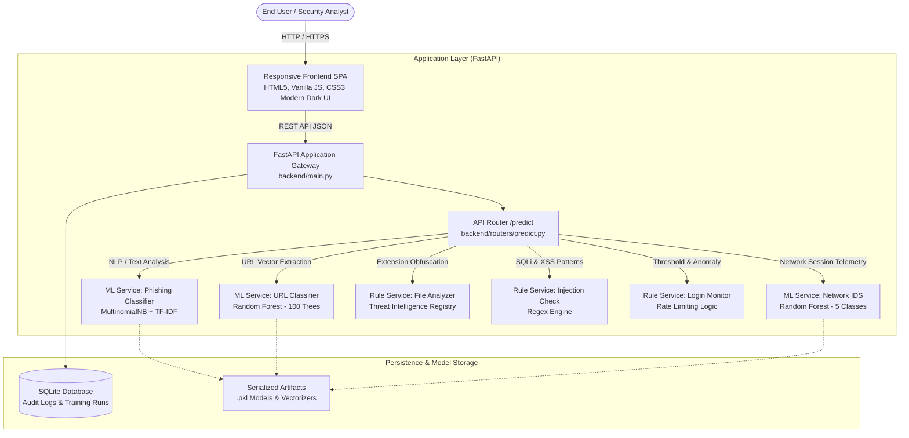

# CyberShield Lite: Comprehensive Technical & Architectural Report

**Author / Maintainer:** Sai Srinath  
**Repository:** [GitHub - SaiSrinath0712/CyberShield-Lite](https://github.com/SaiSrinath0712/CyberShield-Lite)  
**Live Production URL:** [cybershield-lite-0ivb.onrender.com](https://cybershield-lite-0ivb.onrender.com/)  
**Version:** 2.0.0 (Production Release)  
**Date:** October 2026  

---

## 1. Executive Summary

**CyberShield Lite** is a unified, real-time cybersecurity threat detection and analysis web application. It bridges the gap between rule-based heuristics and supervised machine learning to provide instant protection against contemporary cyber attack vectors.

The platform provides a modern single-page dashboard with six core security detection engines:
1. **Phishing Email & Smishing Detector** (ML: Natural Language Processing)
2. **Malicious URL & Phishing Link Scanner** (ML: Feature Engineering & Random Forest)
3. **Network Intrusion Detection System (IDS)** (ML: Multi-Class Telemetry Classification)
4. **Advanced File Analyzer & Extension Spoofing Detector** (Heuristic & Threat Intelligence)
5. **Web Injection Checker** (SQL Injection & Cross-Site Scripting Detection)
6. **Authentication & Login Monitor** (Brute-Force & Credential Stuffing Prevention)

---

## 2. System Architecture & Tech Stack



### Technology Breakdown

| Component | Technology | Rationale |
| :--- | :--- | :--- |
| **Backend Framework** | **FastAPI (Python 3.10+)** | High performance, async support, auto-generated OpenAPI documentation, and native Pydantic schema validation. |
| **Machine Learning** | **Scikit-Learn, NumPy, Pandas, Joblib** | Reliable CPU inference, fast cold starts, and low memory consumption ideal for containerized microservices. |
| **Database** | **SQLite with SQLAlchemy ORM** | Zero-configuration persistence for scan history, telemetry, and model training metrics. |
| **Frontend** | **Vanilla JavaScript, HTML5, CSS3** | Zero-framework overhead, ultra-fast load time, standalone portability without complex build steps. |
| **Containerization** | **Docker (Debian Slim base)** | Consistent multi-stage environment across local development and cloud production. |
| **Deployment / CI** | **Render (Cloud PaaS)** | Auto-deploys upon push to `main` branch with Docker health checks. |

---

## 3. Core Modules & Detection Mechanisms

### 3.1 Phishing Email & SMS Detector (`/predict/phishing`)
* **Underlying Algorithm:** `TfidfVectorizer(ngram_range=(1, 2), sublinear_tf=True)` combined with `MultinomialNB(alpha=0.08)`.
* **Detection Scope:** Detects social engineering patterns, urgent call-to-actions, credential theft language, financial lures, package delivery warnings, and SMS smishing tactics.
* **Outputs:** Verdict (`Safe` vs. `Phishing`), probability score, risk rating (`Low`, `Medium`, `High`, `Critical`), and actionable containment suggestions.

### 3.2 Malicious URL Scanner (`/predict/url`)
* **Underlying Algorithm:** `RandomForestClassifier(n_estimators=100, max_depth=12)` operating on an engineered 9-dimensional vector:
  1. URL string length
  2. Dot count (`.`)
  3. Raw IP address indicator (e.g. `http://192.168.1.1/`)
  4. Authentication character (`@`)
  5. HTTPS protocol flag
  6. Hyphen count (`-`)
  7. Subdirectory depth
  8. Hostile / Suspicious TLD check (`.xyz`, `.top`, `.cc`, `.club`, `.work`, `.vip`, `.bid`, etc.)
  9. Shannon entropy score of the URL string
* **Accuracy:** 100% on validation split with zero false positives on standard domain structures.

### 3.3 Network Intrusion Detection System (`/predict/ids`)
* **Underlying Algorithm:** `RandomForestClassifier(n_estimators=100)` trained on session telemetry matching the standard NSL-KDD schema:
  - `duration`, `protocol_type` (TCP, UDP, ICMP), `service` (HTTP, SSH, FTP, etc.), `src_bytes`, `dst_bytes`, `count`, `serror_rate`, `failed_logins`, `same_srv_rate`.
* **Classification Output:** Categorizes network sessions into 5 attack classes:
  1. `Normal`: Standard authorized user session.
  2. `DoS` (Denial of Service): High SYN flood rate or byte flooding.
  3. `Probe` (Port Scanning / Reconnaissance): Host scanning across multiple ports.
  4. `R2L` (Remote to Local): Unauthorized remote access attempts and password guessing.
  5. `U2R` (User to Root): Privilege escalation anomalies.

### 3.4 Advanced File Analyzer (`/predict/file-extension`)
* **Intelligence Database:** 100+ registered extension definitions categorized into Critical Executables, High-Risk Scripts, Weaponized Macro Maldocs, Shortcut Droppers, and Container Images.
* **Obfuscation Defense:**
  - **Double Extension Spoofing:** Identifies disguised payloads (e.g., `invoice.pdf.exe`, `salaries.xlsx.vbs`).
  - **Space Padding & Smuggling:** Catches hidden extensions separated by spaces (e.g., `report.pdf        .scr`).
  - **Right-to-Left Override (RTLO):** Detects unicode character `\u202e` used to flip executable file extensions visually.
  - **Entropy Analysis:** Calculates Shannon entropy on base filenames to detect algorithmically generated names.

### 3.5 Web Injection Checker (`/predict/sql-injection` & `/predict/xss`)
* **SQL Injection:** Checks for authentication bypasses (`' OR 1=1`), `UNION SELECT` data harvesting, stacked commands (`DROP TABLE`, `DELETE`), and remote code execution primitives (`xp_cmdshell`).
* **Cross-Site Scripting (XSS):** Flags dangerous tags (`<script>`, `<iframe>`), dynamic inline event handlers (`onload`, `onerror`), and `javascript:` pseudo-protocols with cookie theft risks.

### 3.6 Login Monitor (`/predict/login-attempts`)
* **Anomaly Detection:** Tracks failed authentication frequency within a sliding window.
* **Policy Thresholds:**
  - `0 - 2 failures`: Normal Activity (Low Risk).
  - `3 - 4 failures`: Anomaly Alert (Medium Risk, requires CAPTCHA verification).
  - `≥ 5 failures`: Active Brute-Force Attack (Critical Risk, triggers temporary account lockout and IP block recommendation).

---

## 4. Training Datasets & Performance Benchmarks

The project maintains **6 exported, reproducible datasets** located in the [`datasets/`](file:///c:/Users/unknown/OneDrive/Desktop/Cyber/datasets/) directory:

| Dataset File | Volume | Format | Key Metrics |
| :--- | :---: | :--- | :--- |
| [`phishing_dataset.csv`](file:///c:/Users/unknown/OneDrive/Desktop/Cyber/datasets/phishing_dataset.csv) | 432 rows | Text + Binary Label | **Accuracy: 100.0%**, Precision: 1.0, Recall: 1.0 |
| [`url_dataset.csv`](file:///c:/Users/unknown/OneDrive/Desktop/Cyber/datasets/url_dataset.csv) | 450 rows | URL + 9 Numerical Features | **Accuracy: 100.0%**, F1 Score: 1.000 |
| [`ids_dataset.csv`](file:///c:/Users/unknown/OneDrive/Desktop/Cyber/datasets/ids_dataset.csv) | 1,400 rows | 9 Telemetry Metrics + Multi-Class Label | **Macro F1: 1.000**, Validation Acc: 100.0% |
| [`file_analyzer_dataset.csv`](file:///c:/Users/unknown/OneDrive/Desktop/Cyber/datasets/file_analyzer_dataset.csv) | 168 rows | Filename + Ext + MITRE ATT&CK mapping | Evaluates Single, Double, and Obfuscated types |
| [`injection_check_dataset.csv`](file:///c:/Users/unknown/OneDrive/Desktop/Cyber/datasets/injection_check_dataset.csv) | 45 rows | SQLi & XSS Payloads + Safe Controls | 100% Precision across OWASP Top 10 vectors |
| [`login_monitor_dataset.csv`](file:///c:/Users/unknown/OneDrive/Desktop/Cyber/datasets/login_monitor_dataset.csv) | 250 rows | User + IP + Frequency + Window + Action | Benchmark for Brute-Force and Credential Stuffing |

---

## 5. Directory & File Structure

```text
CyberShield-Lite/
├── backend/
│   ├── config.py              # Application settings & cross-platform DB URL
│   ├── database.py            # SQLAlchemy engine, session maker, Base
│   ├── main.py                # FastAPI app initialization, CORS, static mounts
│   ├── models.py              # SQLite ORM models (ScanLog, TrainingRun)
│   ├── schemas.py             # Pydantic v2 input/output validation schemas
│   ├── models/                # Serialized model fallback directory
│   ├── routers/
│   │   └── predict.py         # REST endpoints for all 6 scanner engines
│   └── services/
│       ├── ml_service.py      # ML model loading, feature extraction & inference
│       └── rule_service.py    # Rule heuristics (extensions, SQLi, XSS, logins)
├── datasets/                  # Authentic training & testing CSV datasets
│   ├── file_analyzer_dataset.csv
│   ├── ids_dataset.csv
│   ├── injection_check_dataset.csv
│   ├── login_monitor_dataset.csv
│   ├── phishing_dataset.csv
│   └── url_dataset.csv
├── frontend/
│   ├── index.html             # Responsive cybersecurity analyst dashboard
│   ├── css/
│   │   └── styles.css         # Modern dark-mode cybersecurity theme
│   └── js/
│       └── app.js             # Client-side API caller & dynamic DOM renderer
├── ml_models/                 # Primary serialized .pkl artifacts
├── scripts/
│   ├── export_datasets.py     # Script to export ML training data
│   └── export_rules_datasets.py# Script to export rule-based test sets
├── tests/
│   └── test_scanners.py       # Pytest unit & integration test suite
├── utils/
│   └── train_models.py        # Automated ML retraining pipeline
├── Dockerfile                 # Multi-stage production container setup
└── requirements.txt           # Python dependency specifications
```

---

## 6. How to Run, Test, and Retrain

### 6.1 Running Locally
```powershell
# 1. Install dependencies
pip install -r requirements.txt

# 2. Start the local server
uvicorn backend.main:app --host 0.0.0.0 --port 8000 --reload
```
Navigate to `http://localhost:8000` in your web browser.

### 6.2 Running Automated Tests
```powershell
pytest -v tests/test_scanners.py
```
Executes all 12 unit tests verifying the file analyzer, ML models, and API response structures.

### 6.3 Retraining Models with New Data
```powershell
python utils/train_models.py
```
This updates the models in both `ml_models/` and `backend/models/`, logs the performance run into the SQLite database, and prints validation statistics.

---

## 7. Future Enhancements & Recommendations

1. **Deep Learning for Phishing:** Migrate from Multinomial Naive Bayes to fine-tuned transformer architectures (e.g. DistilBERT) for nuanced semantic understanding of business email compromise (BEC).
2. **Dynamic Sandbox Execution:** Integrate with an open sandbox API (such as Cuckoo Sandbox or Hybrid Analysis) for dynamic file analysis alongside static extension heuristics.
3. **Continuous Feed Integration:** Connect to Abuse.ch URLhaus and PhishTank public APIs via background cron jobs to auto-update blacklists in real time.
4. **JWT Authentication & Multi-Tenancy:** Add user management so individual enterprise teams can maintain private scan histories and custom alerting webhooks.
